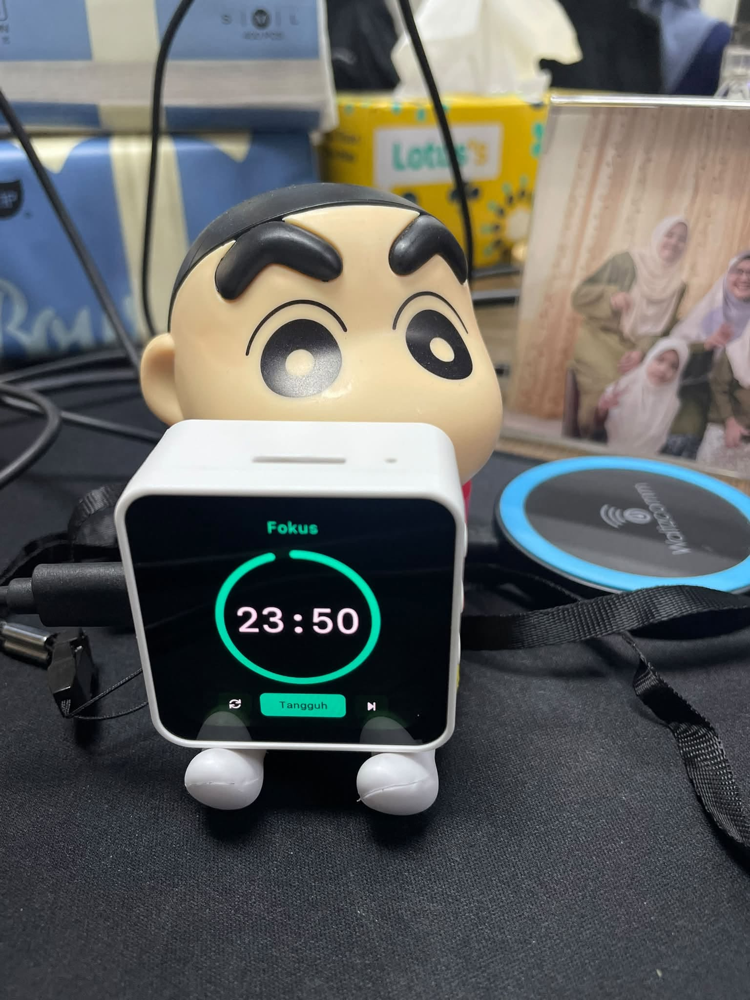

# s3-desk

ESP32-S3 AMOLED desk display with swipeable screens: Malaysian prayer times (JAKIM e-Solat) with azan, clock and
Pomodoro. Malay UI, auto-rotate, web setup.

<p align="center">
  
</p>

https://github.com/user-attachments/assets/e9146312-0537-4986-9cde-1390d4f06b29

[Watch on YouTube](https://youtu.be/GoqYd1FkH3o)


## Screens

Swipe left or right, or press the right-hand button, to cycle through four screens.

- **Senarai**: today's prayer times, with the next one highlighted.
- **Jam**: an analog clock plus the date in the Gregorian and Hijri calendars.
- **Kiraan**: a countdown to the next prayer.
- **Pomodoro**: 25 minutes of Fokus, then 5 minutes of Rehat. When each phase ends, the screen pulses silently.

At each prayer time the azan plays, once per prayer, and you tap the screen to stop it. Hold the right-hand
button to open **Tetapan** (settings): azan per prayer, volume, brightness, night dimming, auto-rotate, theme and
zone.

A short press of the power button turns the screen off. While it is off, touch, the sensors and rendering sleep,
but the azan still plays and the Pomodoro still alerts.

Wi-Fi is off most of the time. The board keeps time with its RTC chip and connects every 6 hours to
sync the clock, plus once a week to refresh the prayer times. It also connects while Tetapan is open and for 10
minutes afterwards.

## Hardware

[Waveshare ESP32-S3-Touch-AMOLED-2.16](https://www.waveshare.com/esp32-s3-touch-amoled-2.16.htm): 480×480 CO5300
AMOLED, CST9217 touch, QMI8658 motion sensor (used for auto-rotate), ES8311 speaker codec and AXP2101 power chip.

## Build and flash

Needs ESP-IDF 5.5.

```sh
idf.py build
idf.py -p /dev/cu.usbmodem* flash   # app and the storage partition (azan, cached times)
tools/check.sh                      # host tests, simulator screenshots, firmware build
```

## First setup

1. On first boot the board opens a Wi-Fi access point and shows a QR code. Scan it with your phone.
2. Choose your home Wi-Fi.
3. Open `http://waktusolat.local` to change the zone, upload your own azan MP3, or update the firmware. The PIN
   for these pages is shown in Tetapan. Open Tetapan first so that Wi-Fi is on. The page keeps it on while it
   stays open.

Prayer times come from [JAKIM e-Solat](https://www.e-solat.gov.my) (default zone SGR03, Klang) and are cached
for offline use. [Mawaqit](https://mawaqit.net) is optional.

## Layout

| Path | What's there |
| --- | --- |
| `components/core/` | Plain C logic: timetables, schedule, settings, Pomodoro, orientation. Unit-tested on the host. |
| `components/ui/` | LVGL screens and the Paper Mono fonts. |
| `main/` | Firmware: display, audio, Wi-Fi, web API, serial console. |
| `sim/` | Headless simulator that renders every screen to PNG. |
| `test/` | Unity host tests. |

## License

[MIT](LICENSE). Third-party credits are in [NOTICE.md](NOTICE.md).
